# Rust TUI Manager

Gestor de tareas colaborativo, multiusuario y self-hosted, escrito en Rust. Un único servidor y tres clientes: una **TUI** (ratatui), una **app gráfica** (Tauri 2) y una **web** que el propio servidor sirve, con actualizaciones en tiempo real entre todos los conectados.

| Pieza | Crate / ruta | Qué es |
|---|---|---|
| Servidor | [`rust-tui-manager-server`](crates/server) (binario `tm-server`) | API REST + WebSocket sobre axum y SQLite |
| Cliente de terminal | [`rust-tui-manager`](crates/tui) | Tablero kanban con ratatui |
| Cliente gráfico | [`apps/desktop`](apps/desktop) | App Tauri 2 (la misma interfaz que la web, en ventana propia) |
| Cliente web | [`crates/server/web`](crates/server/web) | Interfaz gráfica servida por `tm-server` en `/`: tablero, calendario, Gantt, pizarra, bandeja |
| Modelos compartidos | [`rust-tui-manager-core`](crates/core) | Tipos y eventos usados por todos |

> La versión 0.1.x de `rust-tui-manager` era un gestor local de notas y snippets. Ese código sigue en [`legacy/`](legacy/) y en las versiones 0.1.x del crate.

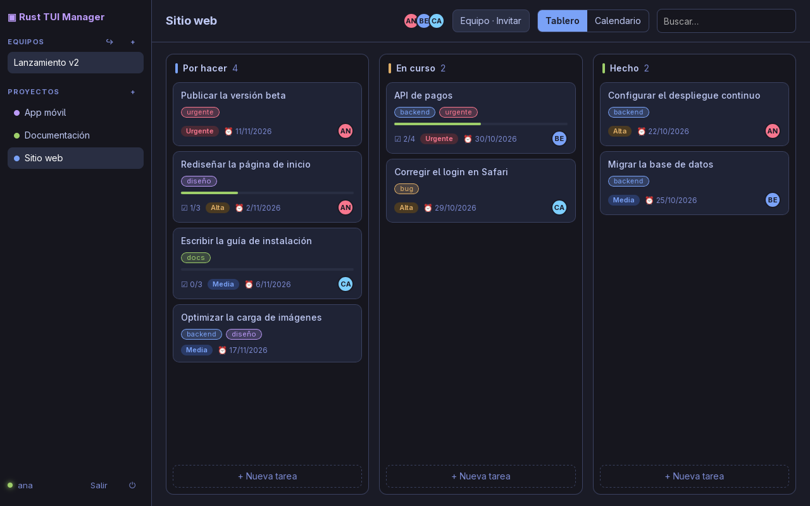

<table>
  <tr>
    <td>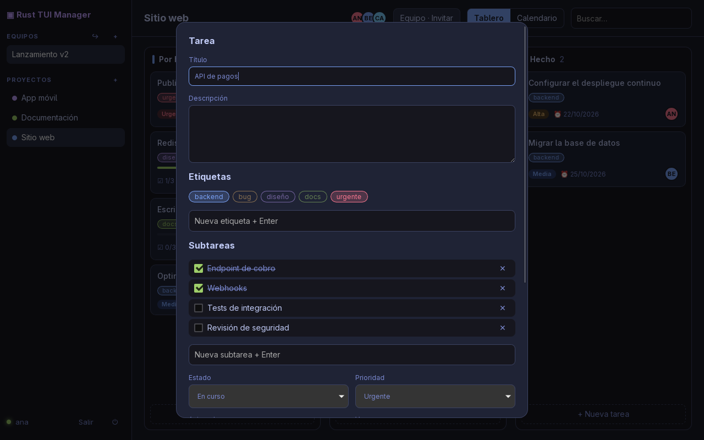</td>
    <td>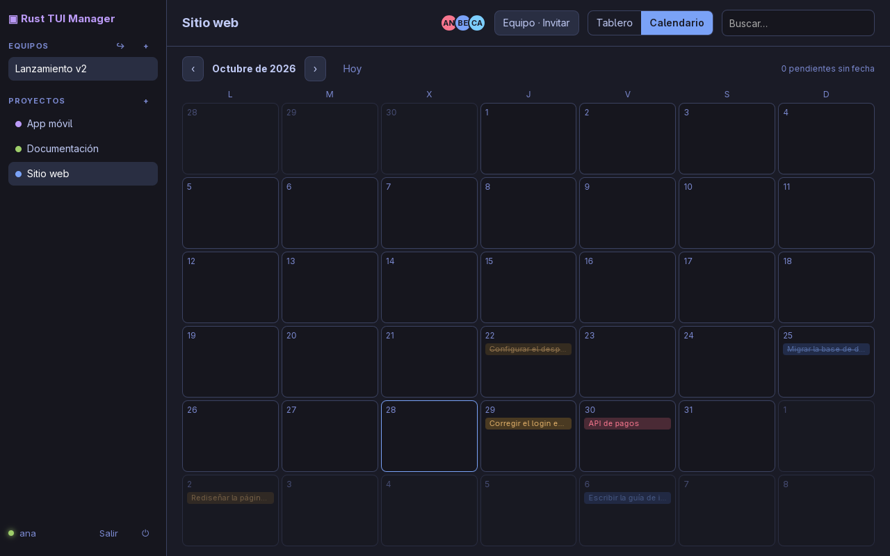</td>
  </tr>
  <tr>
    <td>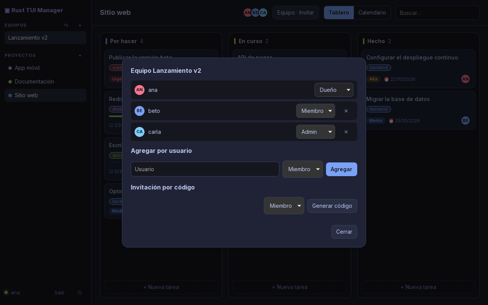</td>
    <td>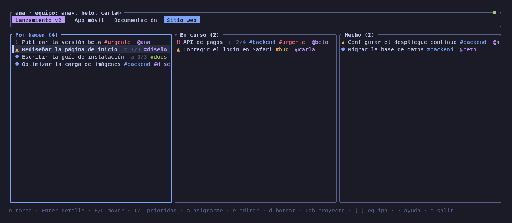</td>
  </tr>
</table>

### Cliente web (también en la app de escritorio)

`tm-server` sirve la interfaz en `/`: abrí `http://tu-servidor:7878` y listo.

<table>
  <tr>
    <td>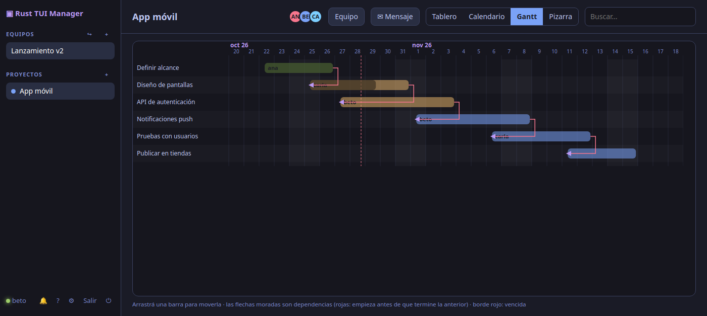</td>
    <td>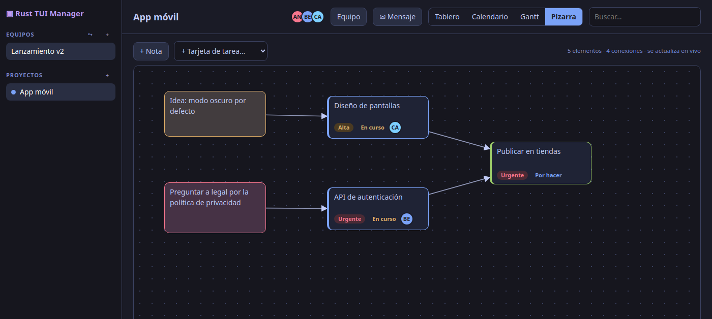</td>
  </tr>
  <tr>
    <td>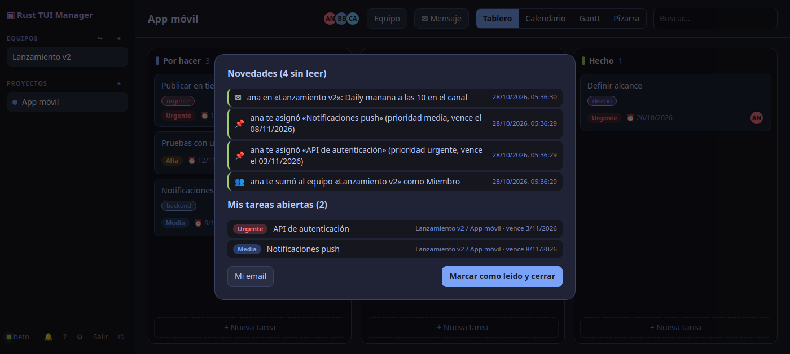</td>
    <td>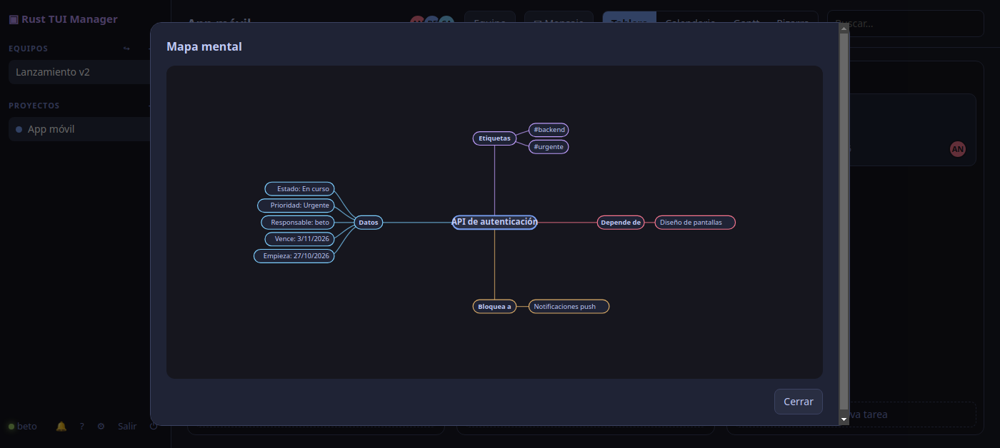</td>
  </tr>
  <tr>
    <td>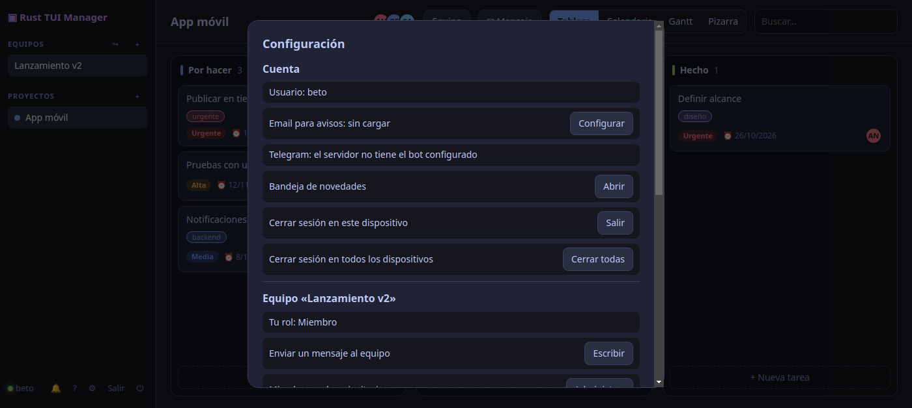</td>
    <td>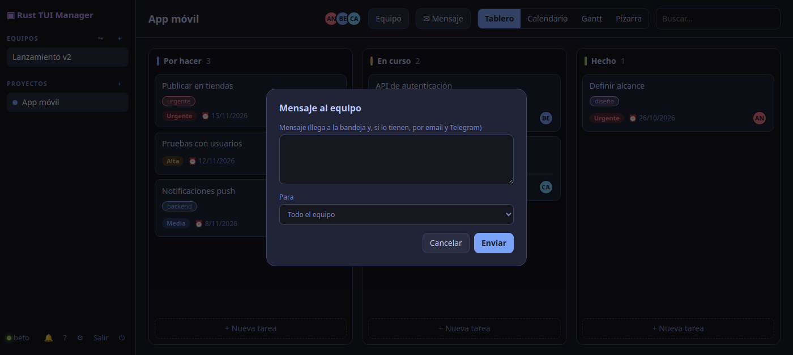</td>
  </tr>
</table>

## Funciones

- **Equipos** con roles (lector, miembro, admin, dueño) e **invitaciones por código** con vencimiento y cupo de usos.
- **Proyectos y tablero kanban** (por hacer / en curso / hecho), prioridades, fechas límite y asignación.
- **Etiquetas** por equipo y **subtareas** con barra de progreso.
- **Comentarios** por tarea.
- **Calendario** mensual por fecha límite, **Gantt** con dependencias entre tareas (arrastrá las barras para mover fechas), **pizarra** colaborativa por proyecto (notas, tarjetas de tarea y conexiones) y **mapa mental** de cada tarea (cliente gráfico).
- **Responsable**: el líder (admin o dueño) asigna a cualquier miembro; un miembro solo toma tareas libres o suelta la suya.
- **Bandeja de novedades**: al iniciar sesión ves lo que pasó mientras no estabas (te asignaron, comentaron, te sumaron) y tus tareas abiertas; llega en vivo y, si cargás y verificás tu email, también por correo.
- **Cliente web**: `tm-server` sirve la misma interfaz gráfica en `/` (abrí `http://tu-servidor:7878` en el navegador, sin instalar nada; `TM_WEB=0` lo desactiva).
- **Telegram** (opcional): cada usuario vincula su cuenta con el bot y recibe por ahí las novedades; cualquier miembro puede mandar **mensajes al equipo** (bandeja, email y Telegram).
- **Agregar miembros con búsqueda** por prefijo de usuario, atajos con prefijo `Ctrl+T` y **ayuda con buscador** (`?`) en ambos clientes.
- **Tiempo real**: un cambio de cualquier usuario aparece al instante en todos los clientes del equipo.

## Instalación rápida

```sh
cargo install rust-tui-manager-server   # instala el binario `tm-server`
cargo install rust-tui-manager          # cliente de terminal
```

O desde este repositorio:

```sh
cargo run -p rust-tui-manager-server                          # servidor en 0.0.0.0:7878
cargo run -p rust-tui-manager -- http://127.0.0.1:7878        # cliente TUI (F2 = crear cuenta)
cargo run -p tm-desktop                                       # cliente gráfico
```

El cliente gráfico necesita las dependencias de Tauri (en Linux: `webkit2gtk-4.1`, `libsoup-3.0`).

## Configuración del servidor

| Variable | Por defecto | Descripción |
|---|---|---|
| `TM_ADDR` | `0.0.0.0:7878` | Dirección donde escucha |
| `TM_DATABASE` | `sqlite://tm-server.db` | Base de datos (se crea con permisos `0600`) |
| `TM_JWT_SECRET` | generado y guardado en la base | Secreto de los tokens; mínimo 32 caracteres |
| `TM_CORS_ORIGINS` | Tauri y localhost | Orígenes extra permitidos, separados por coma |
| `TM_TLS_CERT` / `TM_TLS_KEY` | — | Certificado y clave PEM para servir HTTPS directamente |
| `TM_TRUSTED_PROXY` | — | `1` si corre detrás de un proxy inverso propio (usa `X-Forwarded-For` para el rate limit) |

Para los avisos por correo (opcionales; sin esto solo funciona la bandeja):

| Variable | Descripción |
|---|---|
| `TM_SMTP_URL` | Servidor SMTP, p. ej. `smtps://smtp.ejemplo.com:465` o `smtp://127.0.0.1:2525` |
| `TM_SMTP_FROM` | Remitente, p. ej. `Tareas <avisos@ejemplo.com>` |
| `TM_SMTP_USER` / `TM_SMTP_PASSWORD` | Credenciales, si el servidor las pide |

Para Telegram, creá un bot con [@BotFather](https://t.me/BotFather) y pasale el token al servidor:

| Variable | Descripción |
|---|---|
| `TM_TELEGRAM_TOKEN` | Token del bot. El servidor lo atiende por *long polling*: no necesita URL pública ni HTTPS propio |

Cada usuario lo vincula en **Configuración → Telegram** (web/escritorio) o con `Ctrl+T g` (TUI): genera un código de un solo uso (15 min) y se lo manda al bot como `/start CÓDIGO`; `/stop` desvincula. Solo se escribe a chats vinculados así, nunca a ids arbitrarios.

Cada usuario carga su email y lo confirma con un código de 6 dígitos; solo a las direcciones verificadas se les envían avisos (tope por hora).

Sin TLS propio, ponelo detrás de un proxy TLS antes de exponerlo a internet.

## Seguridad

- Contraseñas con argon2; tokens JWT de 7 días revocables con "cerrar sesión en todos los dispositivos".
- Bloqueo por cuenta (5 fallos = 15 minutos) y limitación por IP en login, registro y WebSocket.
- Límites de tamaño de cuerpo, de largo de cada campo y de cantidad por recurso en todos los endpoints.
- CORS restringido, cabeceras de seguridad y CSP estricta en la app Tauri.
- El token del WebSocket no viaja en la URL: se envía como primer mensaje.
- Los códigos de invitación se guardan hasheados y solo se muestran al crearlos.

## Roles

| Rol | Puede |
|---|---|
| Lector | Ver todo |
| Miembro | Crear y editar tareas, subtareas, comentarios, etiquetas y proyectos |
| Admin | Además, agregar o quitar miembros de rango menor, cambiar roles e invitar |
| Dueño | Todo; no puede abandonar el equipo |

Nadie puede otorgar un rol igual o superior al propio.

## Estructura

```
crates/core      modelos y eventos compartidos
crates/server    servidor axum + SQLite + WebSocket
crates/tui       cliente de terminal
apps/desktop     cliente Tauri (frontend estático en ui/)
legacy/          gestor local anterior (0.1.x)
```

## Licencia

MIT
