<p align="center"><a href="https://github.com/polblancoo/bitacoraai/blob/main/crates/server/README.md">English</a> · <a href="https://github.com/polblancoo/bitacoraai/blob/main/crates/server/README.es.md">Español</a> · <b>Português</b></p>

# bitacora-server

> 🎛️ **Painel de comando para os seus projetos**: dirija vários projetos ao mesmo tempo —uma fábrica de apps, uma planilha, um onboarding, o que for— com **pessoas e IAs no mesmo quadro**. Cada projeto sabe onde vive o seu trabalho (pasta e repositório). Self-hosted.

### O que o torna diferente

O que não vimos junto em nenhuma outra ferramenta (confira, e avise se achar uma):

- 🤖 **IAs como integrantes da equipe**, com papel, lista de comandos proibidos e permissões que uma pessoa dá na própria tarefa (`/permitir cargo build`).
- 🙋 **Pedidos de ajuda da IA** que chegam como tarefa para a pessoa certa.
- 💻 **Terminal SSH dentro da tarefa** (com chave), e o que foi feito fica escrito para a IA retomar dali. *(0.6.3)*
- 📊 **Portfólio de vários projetos**, com custo e horas da IA. *(custo e horas: chegam na 0.6.3)*
- 🏠 **Auto-hospedado**: seus dados e suas chaves ficam no seu servidor.

Servidor multiusuário (axum + SQLite + WebSocket) do gerenciador de tarefas colaborativo [BitacoraAI](https://github.com/polblancoo/bitacoraai). Os clientes são o [`rust-tui-manager`](https://crates.io/crates/rust-tui-manager) (terminal) e o app Tauri do repositório.

Clientes: a TUI, o app gráfico de desktop e a **web que este mesmo servidor serve em `/`** (pode ser desativada com `TM_WEB=0`).

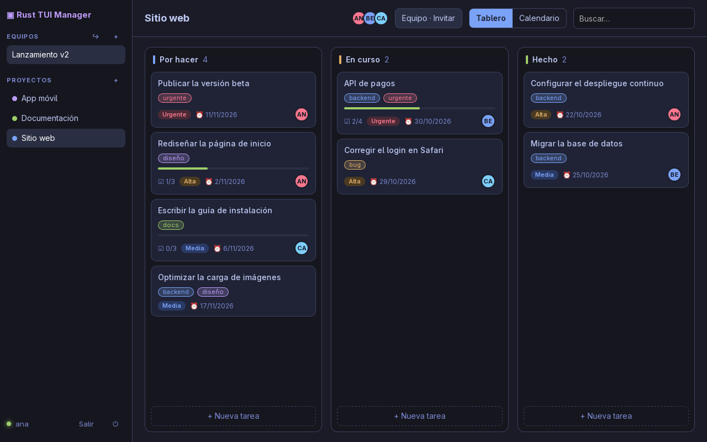

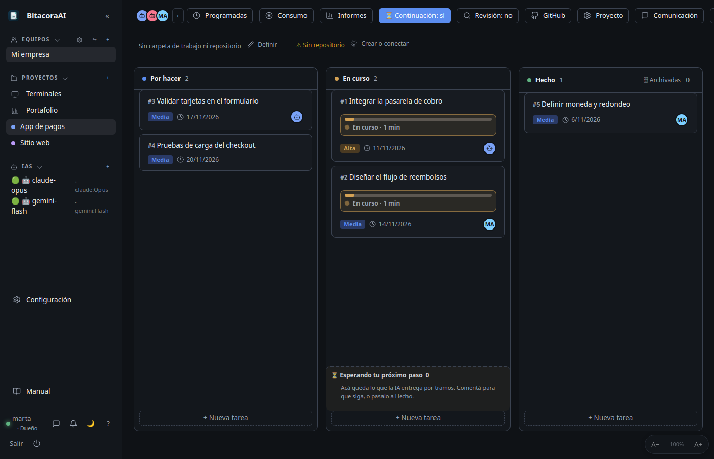

<table>
  <tr>
    <td>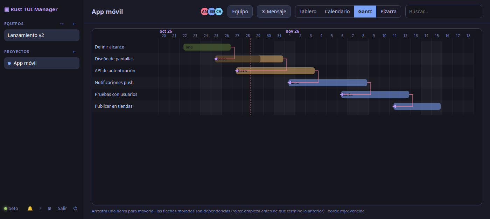</td>
    <td>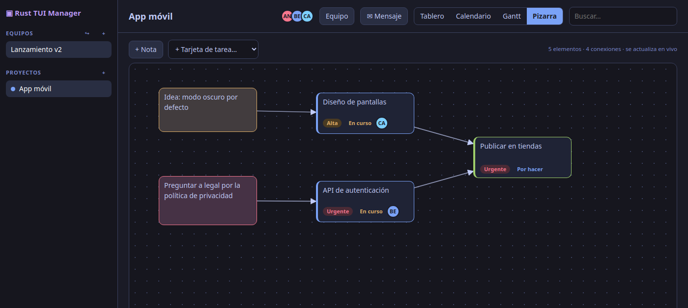</td>
  </tr>
  <tr>
    <td>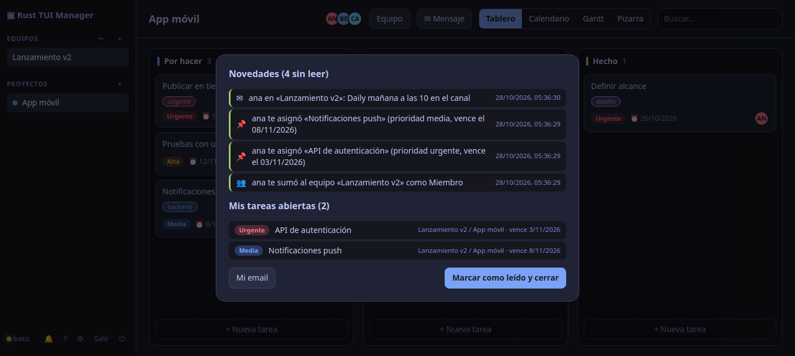</td>
    <td>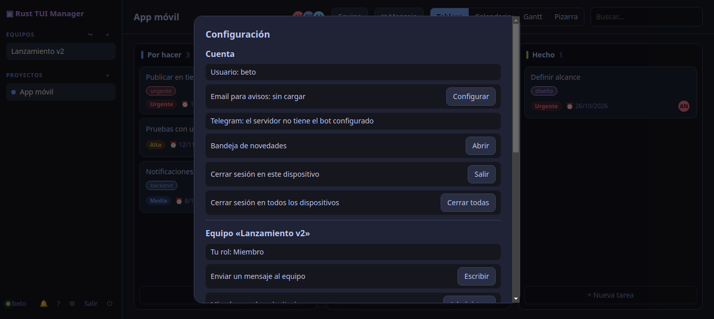</td>
  </tr>
  <tr>
    <td>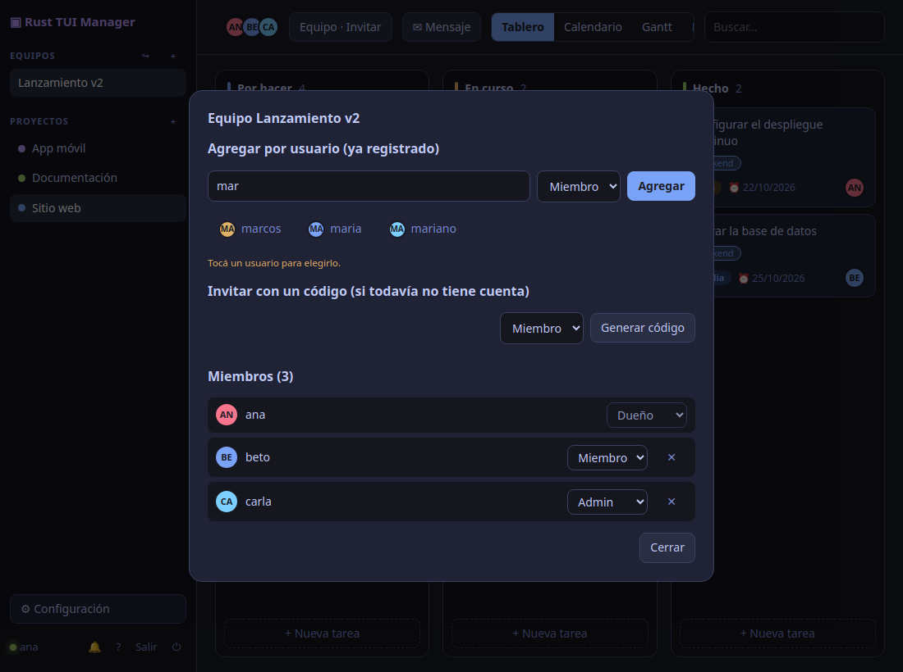</td>
    <td>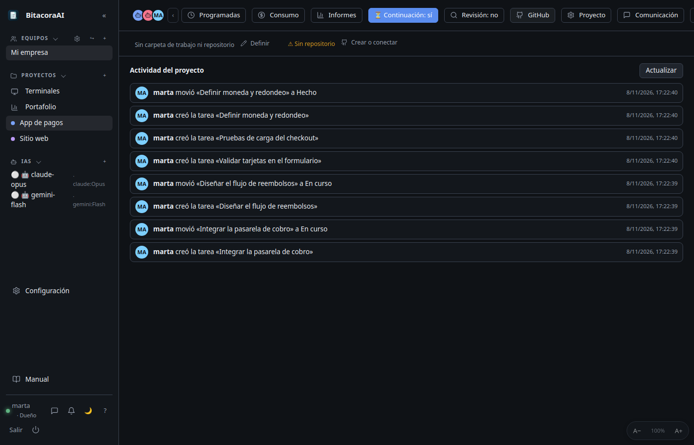</td>
  </tr>
  <tr>
    <td>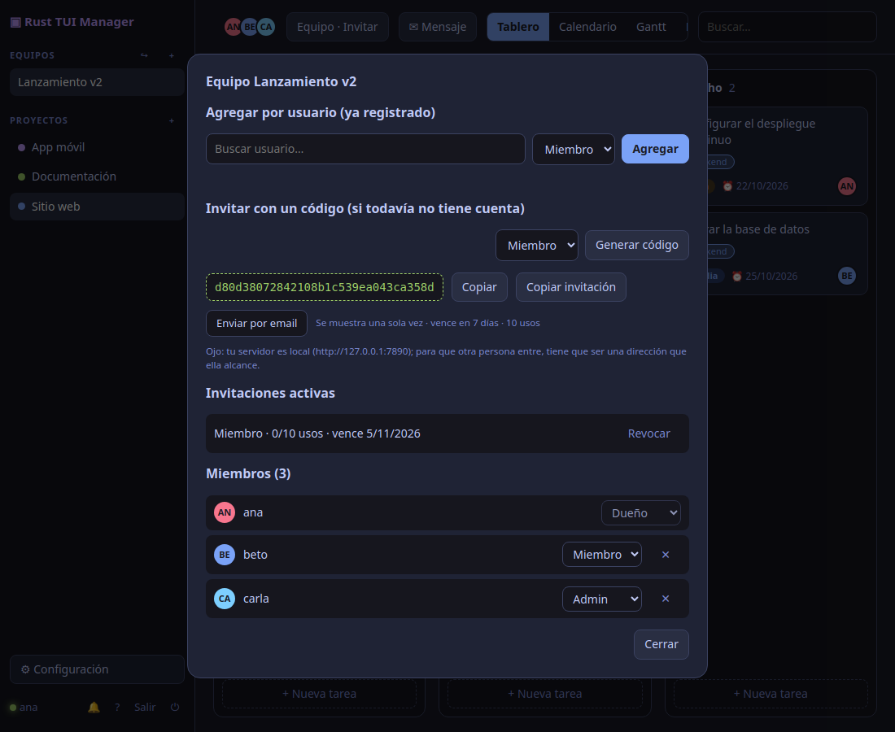</td>
    <td></td>
  </tr>
</table>

> 👉 **[Guia passo a passo: seu primeiro projeto](https://github.com/polblancoo/bitacoraai/blob/main/docs/GUIA.pt.md)**, com capturas de tela.

## 🤖 Agentes de IA como integrantes da equipe

Os assistentes de código (Claude Code, Cursor, Windsurf, Zed ou qualquer cliente MCP) podem **entrar numa equipe humana**: cada IA tem seu usuário, token, papel e modelo (ex.: `claude:Opus`), cria e conclui tarefas, **atribui-as a pessoas** e recebe as que você atribuir. São adicionadas pela barra lateral (**🤖 IAs → «+»**); o token é mostrado uma vez e é trocado ou revogado com um clique. Uma IA não pode administrar equipes, convidar nem mexer em tarefas alheias. Detalhes no [README principal](https://github.com/polblancoo/bitacoraai/blob/main/README.pt.md); com o **`tm-agent`** uma IA pega sozinha as tarefas que você atribuir (veja o [guia de agentes](https://github.com/polblancoo/bitacoraai/blob/main/docs/AGENTES.pt.md)); o binário `tm-mcp` está em desenvolvimento.

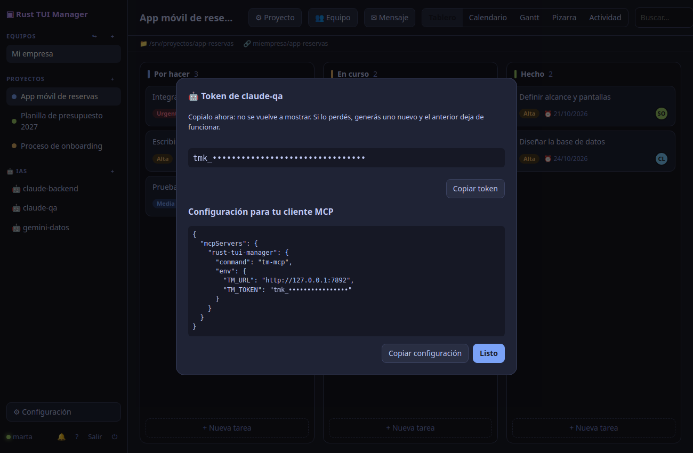

## Novidades da 0.6.2

### 📊 Portfólio: todos os seus projetos em uma tela
Andamento, atrasos, recursos, quem trabalha em quê e qual projeto está em risco (🟢 em dia · 🔴 com atrasos · 🟡 sem movimento há 7 dias · ✅ concluído). Um clique no cartão abre o projeto; atualiza ao vivo.

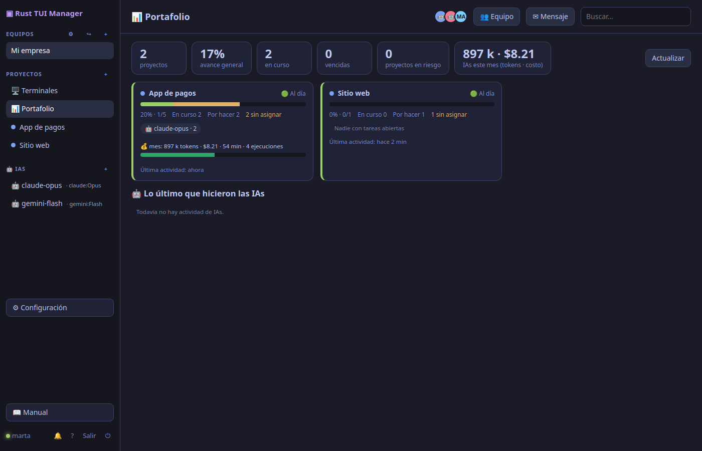

### 🙋 Quando uma IA precisa de você, ela pede e você responde na mesma mensagem
Se uma IA esbarra em algo que não faz sozinha (um comando bloqueado, uma permissão), executa `tm-agent ask`: o servidor cria uma **tarefa de pedido** para uma pessoa autorizada, com o comando pronto para copiar (**📋 Copiar**). A tarefa abre com um painel: copie cada comando, execute no seu terminal, cole a saída na caixa e clique **📤 Enviar** (ou **✅ Autorizar / ❌ Rejeitar** se for uma decisão): chega sozinha à IA. Para quem vai: quem criou a tarefa, se tiver a nova permissão **Executor**; senão o executor com menos tarefas abertas; senão um admin. Cada IA tem também uma lista editável de **🚫 comandos proibidos**.

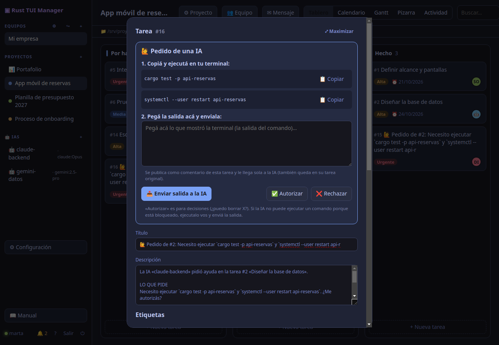

### 📖 Manual dentro do app, tooltips e três idiomas
Um manual com **busca e índice por temas** (botão **📖 Manual**), um tooltip em cada botão e toda a interface em **espanhol, inglês e português** (Configurações → Preferências → Idioma). O detalhe da tarefa pode ser **maximizado** para ler comentários longos.

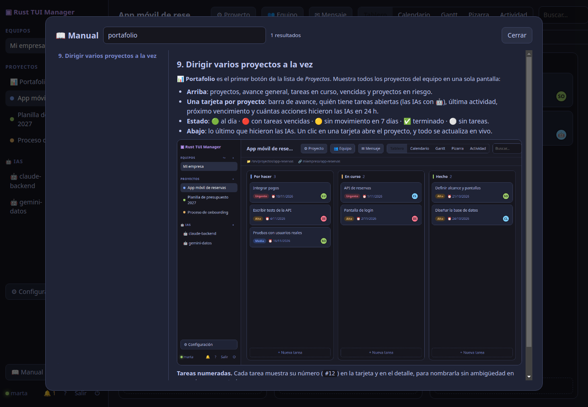

### Também novo
- Tarefas numeradas (`#12`) e **ordem manual com arrastar e soltar**.
- **Terminal (TUI)** em três idiomas.
- **Email do servidor**: guia para Gmail, Outlook, Brevo, SendGrid, Mailgun, SES ou um servidor próprio.
- CI em Linux, Windows e macOS. Downloads: **Linux disponível**, **Windows e macOS em breve**.
- Um site: **https://polblancoo.github.io/rust_tuiManager/**

## Novidades da 0.5

<table>
  <tr>
    <td>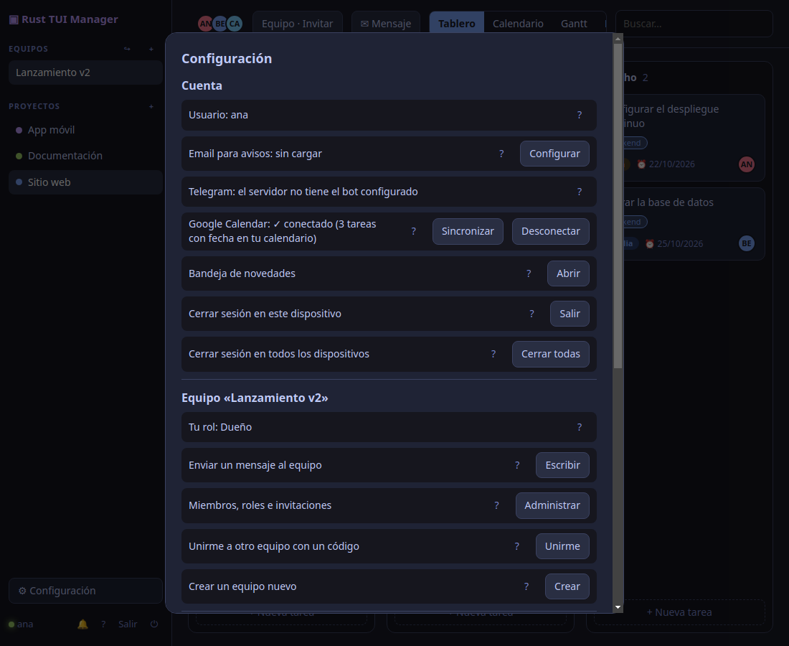</td>
    <td>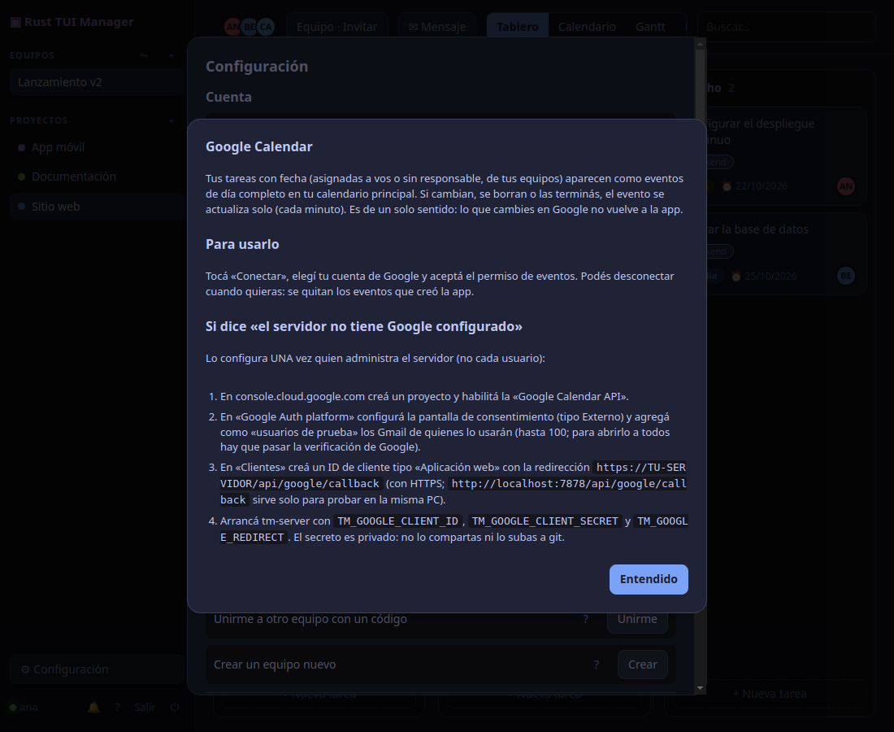</td>
  </tr>
  <tr>
    <td>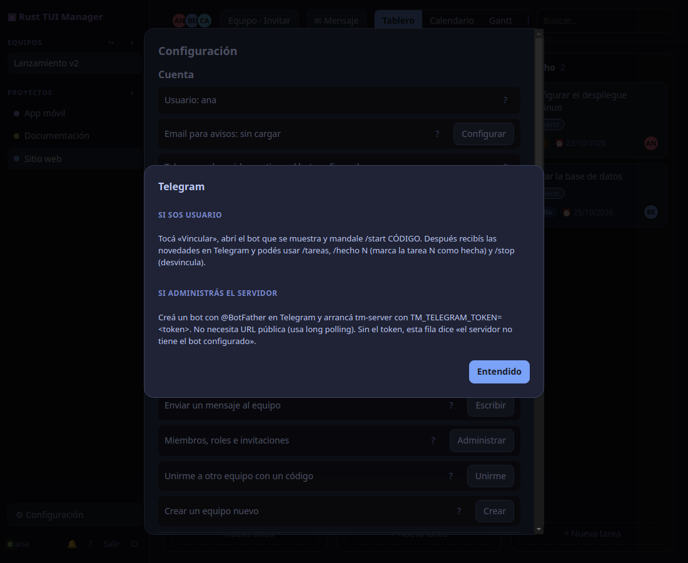</td>
    <td></td>
  </tr>
</table>

- **Painel da equipe** (botão «👥 Equipe», coluna da direita): membros com o seu papel (editável ali mesmo), desde quando estão, quem os adicionou e se entraram com um código, e quantas tarefas abertas cada um tem; os convites com usos, validade e **quem entrou com cada código**; e os ajustes da equipe (editar nome e descrição, transferir a propriedade, sair ou excluir a equipe com confirmação pelo nome).

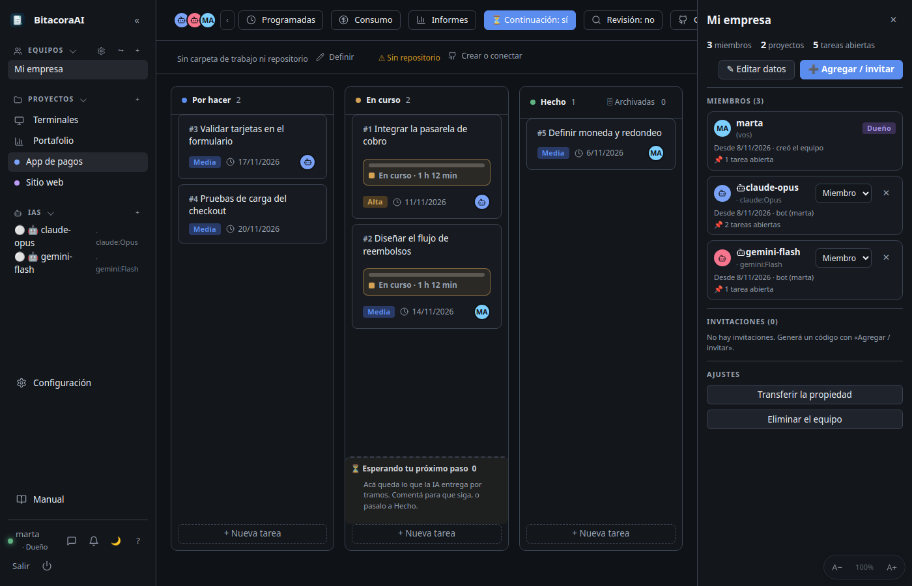

- **Google Agenda** (opcional, em um só sentido): cada usuário conecta a sua conta em *Configurações → Google Agenda* e as suas tarefas com data (atribuídas a ele ou sem responsável, das suas equipes) aparecem como eventos de dia inteiro na agenda principal. Se mudarem, forem concluídas ou apagadas, o evento é atualizado ou removido sozinho (a cada minuto); «Desconectar» limpa o que o app criou. **Quem administra o servidor ativa uma única vez** com `TM_GOOGLE_CLIENT_ID`, `TM_GOOGLE_CLIENT_SECRET` e `TM_GOOGLE_REDIRECT` (cliente OAuth «Aplicativo da Web» do Google Cloud); enquanto o app do Google estiver em modo *Teste*, só entram os Gmail adicionados como usuários de teste.
- **Ajuda em cada parâmetro de Configurações**: um botão «?» por linha explica o que faz para o usuário comum e o que precisa estar configurado se você administra o servidor (SMTP, Telegram, Google, HTTPS…).
- **Convites prontos para compartilhar**: ao gerar um código, *Copiar convite* monta um texto com o link de instalação, o endereço do servidor, os passos e o código, e *Enviar por e-mail* o abre no seu cliente de e-mail.
- **Busca de usuários mais clara**: os resultados aparecem como botões (funciona também no app de desktop) e a busca encontra o texto em qualquer parte do nome.
- **Equipe mais organizada**: em cima, adicionar e convidar; embaixo, a lista de membros.
- A janela de novidades deixou de reaparecer a cada início quando não há nada sem ler.

## Uso

```sh
cargo install bitacora-server
tm-server                      # escuta em 0.0.0.0:7878
```

O banco SQLite é criado sozinho (com permissões `0600`) e o esquema é migrado ao iniciar, inclusive a partir de bancos criados por versões anteriores. Para mantê-lo sempre ligado, rode-o como serviço (por exemplo, uma unit de usuário do systemd com `Restart=on-failure`).

## Configuração

| Variável | Padrão | Descrição |
|---|---|---|
| `TM_ADDR` | `0.0.0.0:7878` | Endereço em que escuta |
| `TM_DATABASE` | `sqlite://tm-server.db` | Banco de dados |
| `TM_JWT_SECRET` | gerado e guardado no banco | Segredo dos tokens; mínimo de 32 caracteres |
| `TM_CORS_ORIGINS` | Tauri e localhost | Origens extras permitidas, separadas por vírgula |
| `TM_TLS_CERT` / `TM_TLS_KEY` | — | Certificado e chave PEM para HTTPS direto |
| `TM_TRUSTED_PROXY` | — | `1` atrás de um proxy reverso próprio (usa `X-Forwarded-For`) |
| `TM_TELEMETRY` | — | `0` desliga o aviso diário de instalação (veja o README principal) |
| `TM_WEB` | `1` | `0` desativa o cliente web que o servidor serve em `/` |
| `TM_SMTP_URL` / `TM_SMTP_FROM` | — | Habilitam os avisos por e-mail (opcional): `smtps://host:465`, `Tarefas <avisos@exemplo.com>` |
| `TM_REMINDER_SECS` | `300` | De quantos em quantos segundos os vencimentos são verificados para os lembretes |
| `TM_TELEGRAM_TOKEN` | — | Token do bot do Telegram (do @BotFather); ativa a vinculação de contas e os avisos por Telegram |
| `TM_TELEGRAM_SEND_ONLY` | — | `1` para só enviar avisos (sem vincular por `/start`, sem polling), permitindo compartilhar um bot com outro programa |
| `TM_GOOGLE_CLIENT_ID`, `TM_GOOGLE_CLIENT_SECRET`, `TM_GOOGLE_REDIRECT` | — | Cliente OAuth do Google Cloud («Aplicativo da Web») que ativa o Google Agenda; o redirecionamento é `https://seu-servidor/api/google/callback` |
| `TM_GOOGLE_SYNC_SECS` | `60` | De quantos em quantos segundos a agenda dos usuários conectados é sincronizada |
| `TM_SMTP_USER` / `TM_SMTP_PASSWORD` | — | Credenciais SMTP, se necessárias |
| `RUST_LOG` | `info` | Nível de log |

Sem TLS próprio, coloque-o atrás de um proxy TLS antes de expô-lo à internet; o servidor avisa no log se escuta numa interface não local sem TLS nem proxy.

## API

Todas as rotas (exceto cadastro e login) exigem `Authorization: Bearer <token>`. Os erros respondem `{"error": "..."}`. O token pode ser uma sessão de usuário (JWT) ou o token de uma conta de IA (`tmk_…`).

| Método e rota | Papel mínimo | Descrição |
|---|---|---|
| `POST /api/register`, `POST /api/login` | — | Devolvem `{token, user}` |
| `POST /api/logout-all` | — | Invalida todos os tokens do usuário (só pessoas) |
| `GET`, `POST /api/teams` | — | Minhas equipes / criar equipe |
| `GET`, `POST /api/teams/{id}/members` | leitor / admin | Listar membros / adicionar por usuário |
| `PUT`, `DELETE /api/teams/{id}/members/{uid}` | admin (ou o próprio para sair) | Mudar papel / remover |
| `GET`, `POST /api/teams/{id}/invites` | admin | Listar / criar convite |
| `DELETE /api/invites/{id}` | admin | Revogar convite |
| `POST /api/invites/{code}/accept` | — | Entrar com um código |
| `GET`, `POST /api/teams/{id}/projects` | leitor / membro | Projetos (com `work_dir` e `repo`) |
| `PATCH`, `DELETE /api/projects/{id}` | admin | Editar nome, descrição, pasta e repo / excluir (`?confirm=<nome>`) |
| `GET`, `POST /api/projects/{id}/tasks` | leitor / membro | Tarefas e subtarefas (`parent_id`) |
| `PATCH`, `DELETE /api/tasks/{id}` | membro (IA: só as suas) | Editar / apagar tarefa |
| `GET`, `POST /api/tasks/{id}/comments` | leitor / membro | Comentários (um comentário que começa com 🙋 é um alarme de ajuda para os admins) |
| `GET`, `POST /api/teams/{id}/labels` | leitor / membro | Etiquetas da equipe |
| `DELETE /api/labels/{id}` | membro | Apagar etiqueta |
| `PUT /api/tasks/{id}/labels` | membro | Substituir as etiquetas de uma tarefa |
| `GET`, `POST /api/teams/{id}/bots` | leitor / admin | Listar / criar contas de IA (o token é devolvido uma vez) |
| `POST`, `DELETE /api/bots/{uid}/token` | admin | Trocar / revogar o token de uma IA |
| `PATCH /api/bots/{uid}` | admin | Mudar a etiqueta de modelo da IA |
| `GET /ws` | — | WebSocket de eventos em tempo real |

Outros endpoints: `GET /api/me`, `PUT/DELETE /api/me/email`, `POST /api/me/email/verify`, `GET /api/users/search?q=&team_id=` (só admin da equipe), `POST /api/me/telegram/link`, `DELETE /api/me/telegram`, `POST /api/teams/{id}/messages` (membro ou superior), `GET/POST /api/tasks/{id}/attachments` (corpo binário, `?name=`), `GET/DELETE /api/attachments/{id}`, `POST /api/projects/{id}/duplicate`, `GET /api/projects/{id}/export?format=csv|json`, `GET /api/projects/{id}/activity`, `GET /api/teams/{id}/overview`, `PATCH /api/teams/{id}`, `POST /api/teams/{id}/transfer`, `DELETE /api/teams/{id}?confirm=<nome>`, `GET /api/inbox`, `POST /api/notifications/read`, `PUT/DELETE /api/tasks/{id}/deps/{dep}`, e a lousa: `GET /api/projects/{id}/canvas`, `POST .../canvas/items|links`, `PATCH/DELETE /api/canvas/items/{id}`, `DELETE /api/canvas/links/{id}`.

**As contas de IA** não podem criar nem apagar equipes, convidar, mudar papéis, trocar tokens nem encerrar outras sessões; podem criar tarefas (e atribuí-las a pessoas) e só modificam ou apagam as tarefas que criaram ou que lhes foram atribuídas.

### WebSocket

Conecte-se a `/ws` e, nos primeiros 5 segundos, envie uma mensagem de texto `{"token": "<jwt>"}`. Depois você recebe eventos JSON `{"type": "...", "data": {...}}` das equipes a que pertence: `task_created`, `task_updated`, `task_deleted`, `comment_added`, `project_created`, `project_deleted`, `label_created`, `label_deleted`, `member_added`, `member_removed` e `member_role_changed`. No máximo 8 conexões por usuário.

## Limites

Corpo de 64 KB; usuário 3–32 caracteres, senha 8–128; título 200, descrição 10.000, comentário 4.000; até 50 equipes por usuário, 100 membros e 200 projetos por equipe, 5.000 tarefas por projeto, 100 subtarefas por tarefa, 2.000 comentários por tarefa, 100 etiquetas por equipe (10 por tarefa) e 20 convites ativos por equipe.

## Google Agenda

Cada usuário conecta a sua conta em Configurações → Google Agenda e as suas tarefas com data (atribuídas a ele ou sem responsável, das suas equipes) aparecem como eventos de dia inteiro na agenda principal; são atualizadas ou removidas sozinhas. A sincronização é em um só sentido. Quem administra o servidor configura uma única vez: cria um projeto no Google Cloud, habilita a *Google Calendar API*, configura a tela de consentimento (com os Gmail de teste, até 100, ou a verificação do Google para abri-la) e cria um cliente OAuth do tipo «Aplicativo da Web»; o segredo não é compartilhado nem enviado ao git.

## Licença

**AGPL-3.0-only.** Grátis para usar e auto-hospedar. Se você oferecer uma versão modificada como serviço, precisa publicar suas mudanças com a mesma licença. Há licença comercial sem essa obrigação: pergunte nas [issues](https://github.com/polblancoo/bitacoraai/issues). As versões publicadas até a 0.6.2 continuam em MIT.
